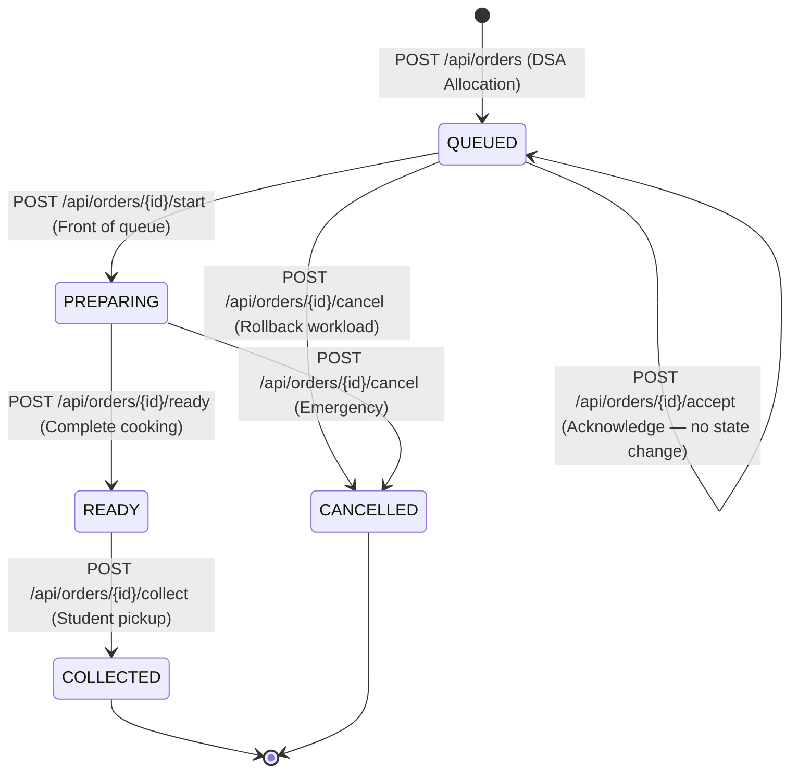

# C++ REST API Documentation

## 1. Overview & Connection Details

The Canteen Queue Optimization System provides a lightweight, multithreaded REST API built using `cpp-httplib` and `nlohmann/json`.

- **Default Port**: `8080` (configurable via `--server [port]`)
- **Base URL**: `http://localhost:8080`
- **Content Type**: `application/json`
- **CORS Policy**: `Access-Control-Allow-Origin: *` with preflight `OPTIONS` handling.

---

## 2. Authentication

Staff-only endpoints require a `Bearer` token obtained via `POST /api/staff/auth`.

| Endpoint category | Auth required |
|---|---|
| GET /api/health, /api/menu, /api/counters, /api/analytics | None |
| POST /api/orders, GET /api/orders, GET /api/orders/:id | None (student-facing) |
| POST /api/orders/:id/start, /ready, /collect, /cancel, /pay, /accept | ✅ `Authorization: Bearer <token>` |

### Token acquisition flow
```
POST /api/staff/auth  { "pin": "1234" }
→ 200 { "token": "<server_token>" }
→ Use token in subsequent staff requests
```

The token is set via the `CANTEEN_STAFF_TOKEN` environment variable on the server. If unset, a development default is used. **In production, always set `CANTEEN_STAFF_TOKEN` to a strong random secret.**

Valid PINs are configured via `CANTEEN_STAFF_PINS` (comma-separated). Default: `1234,canteen2026,admin`.

---

## 3. Order Lifecycle State Machine



Payment is independent of order status:
```
payment_status: PENDING → PAID  (via POST /api/orders/{id}/pay — staff only)
```
Payment cannot be confirmed for CANCELLED orders.

---

## 4. API Endpoints Reference

### `POST /api/staff/auth`
Authenticates a staff member by PIN and returns a server-side token.

- **Auth**: None
- **Body**: `{ "pin": "1234" }`
- **Response 200**: `{ "token": "...", "message": "Staff authenticated successfully" }`
- **Response 401**: `{ "error": "Invalid staff PIN" }`

---

### `GET /api/health`
- **Auth**: None
- **Response 200**:
```json
{
  "active_counters_count": 4,
  "database_connected": true,
  "ml_model_loaded": true,
  "ml_model_source": "RandomForestRegressor JSON (20 trees from ml/model.json)",
  "service": "AI-Based College Canteen Queue Optimization System",
  "status": "healthy"
}
```

---

### `GET /api/menu`
- **Auth**: None
- **Response 200**: Array of menu items.
```json
[{ "id": 101, "name": "Poha", "category": "Breakfast", "price": 30.0, "prep_time_minutes": 7, "is_available": true, "complexity": 2 }]
```

---

### `GET /api/counters`
- **Auth**: None
- **Response 200**: Array of counters with live queue stats.

---

### `POST /api/orders`
Places a new order. No auth required (student-facing).

- **Body**:
```json
{
  "student_id": "STU2025001",
  "student_name": "Riya Sharma",
  "items": [{ "item_id": 101, "quantity": 2 }]
}
```
- **Response 201**: Full order object (see schema below).
- **Response 400**: Invalid items, out-of-stock, malformed JSON.
- **Response 409**: Duplicate idempotency key.

---

### `GET /api/orders`
Paginated order list.
- **Auth**: None
- **Query params**: `limit` (max 100), `offset`, `status` (QUEUED|PREPARING|READY|COLLECTED|CANCELLED)
- **Sort order**: QUEUED and PREPARING → oldest first (FIFO). All other views → newest first.

---

### `GET /api/orders/:id`
- **Auth**: None (student tracking)
- **Response 200**: Full order object.
- **Response 404**: Not found.

---

### `POST /api/orders/:id/accept` ⭐ Staff only
Acknowledges receipt of an incoming QUEUED order. **Does not change order status** — the status remains QUEUED. Logs an `ORDER_ACKNOWLEDGED` entry in the audit log.

- **Auth**: Bearer token required
- **Response 200**: Order object + `{ "acknowledged": true, "message": "..." }`
- **Response 401**: Missing or invalid token.
- **Response 409**: Order not in QUEUED status.

> **Design note**: A separate ACCEPTED status was evaluated but rejected. The existing QUEUED→PREPARING→READY→COLLECTED lifecycle is sufficient. Accept is a non-mutating acknowledgement that appears in the audit log without disrupting FIFO queue ordering or ML counter assignment.

---

### `POST /api/orders/:id/pay` ⭐ Staff only
Confirms manual cash/UPI payment at the counter. **Persists to SQLite.** Payment status survives application restart.

- **Auth**: Bearer token required
- **Response 200**: Order with `"payment_status": "PAID"`
- **Response 401**: Missing or invalid token.
- **Response 404**: Order not found.
- **Response 409**: Order is CANCELLED.

---

### `POST /api/orders/:id/start` ⭐ Staff only
Moves the front-of-queue QUEUED order to PREPARING.

- **Auth**: Bearer token required
- **Constraint**: Order must be at the front of its assigned counter's FIFO queue.

---

### `POST /api/orders/:id/ready` ⭐ Staff only
Marks a PREPARING order as READY for student pickup.

- **Auth**: Bearer token required

---

### `POST /api/orders/:id/collect` ⭐ Staff only
Marks a READY order as COLLECTED.

- **Auth**: Bearer token required

---

### `POST /api/orders/:id/cancel` ⭐ Staff only
Cancels an order (permitted in QUEUED or PREPARING; not in COLLECTED or already CANCELLED).

- **Auth**: Bearer token required

---

### `GET /api/analytics`
- **Auth**: None
- **Response 200**: Live metrics including total order history, pending counts, workload minutes, ML status, and per-counter analytics.

---

## 5. Order Object Schema

```json
{
  "id": 121,
  "student_id": "STU2025001",
  "student_name": "Riya Sharma",
  "status": "QUEUED",
  "payment_status": "PENDING",
  "queue_position": 2,
  "assigned_counter_id": 3,
  "total_prep_time_minutes": 14,
  "total_amount": 85.0,
  "order_timestamp": 1730549020,
  "items": [
    { "item_id": 101, "item_name": "Poha", "price": 30.0, "quantity": 2 },
    { "item_id": 108, "item_name": "Masala Chai", "price": 25.0, "quantity": 1 }
  ]
}
```

`payment_status` values: `PENDING` | `PAID`

---

## 6. Error Response Format

```json
{ "error": "Human-readable error message" }
```

| HTTP Status | Meaning |
|---|---|
| 200 | Success |
| 201 | Order created |
| 204 | Preflight OPTIONS response |
| 400 | Bad request (malformed JSON, invalid params) |
| 401 | Staff authorization required |
| 404 | Resource not found |
| 409 | Invalid state transition or conflict |
| 500 | Server error |

---

## 7. Environment Configuration

| Variable | Description | Default (dev) |
|---|---|---|
| `CANTEEN_STAFF_TOKEN` | Server-side bearer token for staff API | `staff-dev-token-1234` |
| `CANTEEN_STAFF_PINS` | Comma-separated valid staff PINs | `1234,canteen2026,admin` |

> **Security note**: The development defaults are intentionally simple. Always set both variables to strong secrets in any non-development environment.
