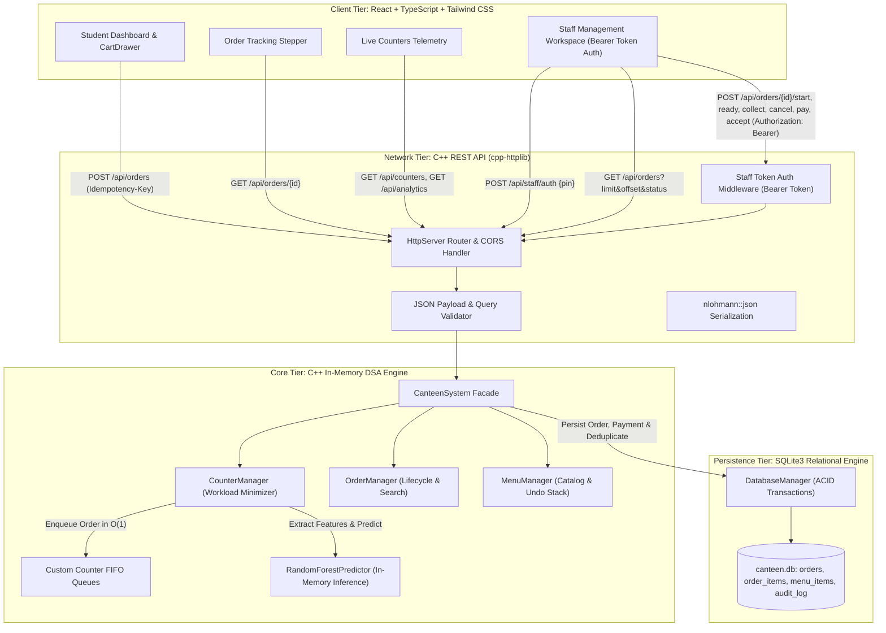
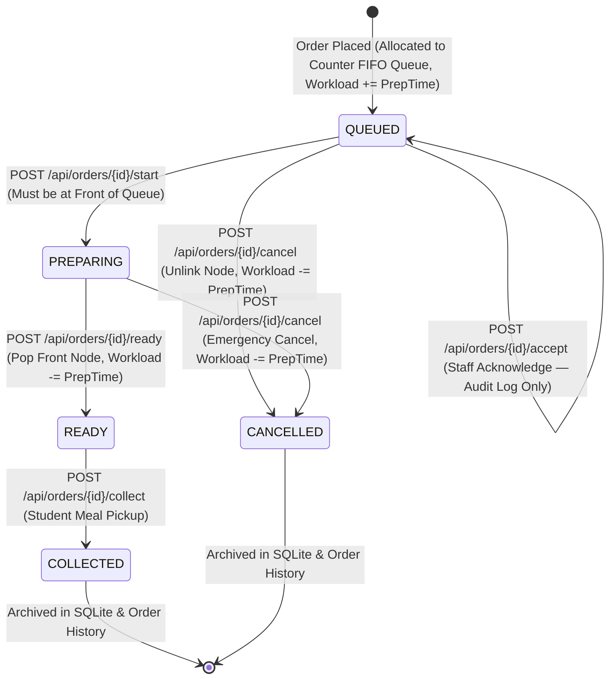
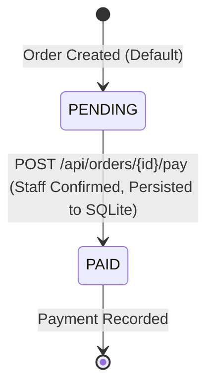

# Architecture & Data Flow Specification

**Project**: AI-Based College Canteen Queue Optimization System  
**System Type**: C++17 Core Engine + SQLite Relational Storage + Multithreaded REST API + React SPA Frontend

---

## 1. High-Level Architecture Overview

The system is organized into a clean, 4-tier modular architecture:



---

## 2. End-to-End Order Placement Sequence

When a student places an order on the React frontend, the request traverses the system as shown below:

```mermaid
sequenceDiagram
    autonumber
    actor Student as Student (Browser)
    participant UI as React CartDrawer
    participant API as C++ HttpServer
    participant Core as CanteenSystem
    participant Sched as CounterManager
    participant ML as RandomForestPredictor
    participant Queue as Counter FIFO Queue
    participant DB as DatabaseManager (SQLite)

    Student->>UI: Click "Confirm & Place Order"
    UI->>UI: Generate UUID v4 Idempotency-Key
    UI->>API: POST /api/orders {student_id, student_name, items, idempotency_key}
    
    API->>API: Validate input (non-empty strings, positive quantities, item availability)
    
    alt Duplicate Request (Idempotency Key Exists)
        API->>DB: findOrderByIdempotencyKey(key)
        DB-->>API: Existing Order Record
        API-->>UI: HTTP 200 OK (Existing Order JSON)
    else New Order Submission
        API->>Core: placeOrder(studentId, studentName, items, preferredCounterId)
        
        loop For Each Available Counter in FixedArray
            Core->>Sched: Evaluate Counter Ci
            Sched->>Sched: Extract Features [Category, Qty, Complexity, Hour, Workload(Ci)]
            Sched->>ML: predict(features)
            ML-->>Sched: Predicted Prep Time (mins)
            Sched->>Sched: Projected Wait = Workload(Ci) + Predicted Prep
        end
        
        Sched->>Sched: Select Counter C* with min(Projected Wait, Counter ID)
        Sched->>Queue: enqueue(newOrder) [O(1)]
        Sched->>Sched: Increment Workload(C*) by Predicted Prep
        Core->>DB: saveNewOrder(newOrder, idempotencyKey)
        DB->>DB: BEGIN TRANSACTION; INSERT INTO orders, order_items; COMMIT;
        
        Core-->>API: Scheduled Order Object
        API-->>UI: HTTP 201 Created (Order ID, Counter ID, Predicted Prep, Status: QUEUED, Payment: PENDING)
        UI-->>Student: Display Order Confirmation Modal
    end
```

---

## 3. Order Lifecycle State Machine & Workload Synchronization

Orders progress through an authoritative in-memory state machine. In-memory queues remain authoritative for active scheduling, while SQLite provides persistent record-keeping.



### Payment Lifecycle


### State Transition Invariants
1. **Front-of-Queue Enforcement**:
   An order cannot transition from `QUEUED` to `PREPARING` or `READY` unless it is currently located at the front of its assigned counter's FIFO queue (`pendingOrders.front().getId() == orderId`). Attempting to bypass the queue returns `HTTP 409 Conflict`.
2. **Deterministic Workload Reclamation**:
   When an order transitions to `READY` (via `completeFrontOrder()`) or `CANCELLED` (via `cancelOrder()`), its predicted preparation time is deducted from the counter's `current_workload_minutes`. Completed and cancelled orders never contribute to active kitchen wait times.
3. **Database Synchronization**:
   Every state transition executes `db.updateOrderStatus(orderId, newStatus)`.
4. **Payment Persistence**:
   `POST /api/orders/{id}/pay` executes `db.updateOrderPaymentStatus(orderId, "PAID")` via a prepared statement. Payment survives restarts. Payments cannot be accepted for CANCELLED orders (`HTTP 409 Conflict`).
5. **Order Acknowledgment**:
   `POST /api/orders/{id}/accept` does not mutate queue position or status; it writes an audit log entry (`ORDER_ACKNOWLEDGED`) and returns `acknowledged: true`.

---

## 4. Application Restart & Crash Recovery Protocol

The system guarantees durable recovery upon application restarts or crashes without data loss or queue duplication:

```mermaid
sequenceDiagram
    autonumber
    participant App as canteen_app (Startup)
    participant Core as CanteenSystem
    participant DB as DatabaseManager (SQLite)
    participant Queue as Counter Queues

    App->>Core: Initialize CanteenSystem("canteen.db")
    Core->>DB: initialize()
    DB->>DB: PRAGMA foreign_keys = ON; Schema Verification & Migrations;
    
    Core->>DB: loadActiveOrders() (Status = QUEUED or PREPARING)
    DB-->>Core: List of Incomplete Orders ordered by order_timestamp ASC
    
    loop For Each Active Order
        Core->>Queue: Enqueue into assignedCounter->getPendingQueue() (Preserves FIFO)
        Core->>Core: Increment assignedCounter Workload by order.prep_time
    end
    
    Core->>DB: loadHistoricalOrders() (Status = READY, COLLECTED, CANCELLED)
    DB-->>Core: Historical Order List (Restores payment_status)
    Core->>Core: Align nextOrderId to max(existing ID) + 1
    
    Note over Core: System fully restored in authoritative in-memory state.
```

---

## 5. API Error Handling & Status Conventions

The REST API layer implements strict HTTP status code conventions:

| HTTP Status | Meaning | When Triggered |
|---|---|---|
| `200 OK` | Query Successful | Idempotent duplicate order lookup, menu fetch, telemetry query, payment confirmation, order acknowledgement. |
| `201 Created` | Resource Created | First-time successful order submission and scheduling. |
| `400 Bad Request` | Client Payload Invalid | Empty student ID/name, empty items list, negative quantities, unavailable items, invalid pagination limits. |
| `401 Unauthorized` | Auth Required / Invalid | Calling staff-protected endpoints without `Authorization: Bearer <token>`, or invalid PIN submitted to `/api/staff/auth`. |
| `404 Not Found` | Entity Missing | Order ID or food item ID does not exist in active queues or database. |
| `409 Conflict` | Illegal Lifecycle Transition | Attempting to start an order not at the front of the queue, paying for a cancelled order, or transitioning already `COLLECTED` / `CANCELLED` orders. |
| `500 Internal Error` | Server Fault | Database transaction deadlock or low-level SQLite disk constraint error. |

---

## 6. Frontend Integration & Data Flow

- **Single Page Architecture**: React 19 SPA running on Vite.
- **Auto-Polling & Dynamic Refresh**: The Live Queues dashboard and staff order tickets poll telemetry every 4–5 seconds to provide real-time updates.
- **Client Idempotency**: The `CartDrawer` generates a UUID v4 idempotency key when the user opens checkout. Retrying a submission on network timeout reuses the same key, guaranteeing zero duplicate orders.
- **Server-Side Authentication**: Staff members log in via `/api/staff/auth`. The resulting Bearer token is stored in `sessionStorage` and sent in the `Authorization` header for all mutating staff actions. Unauthenticated requests are rejected by the C++ backend with HTTP 401.
