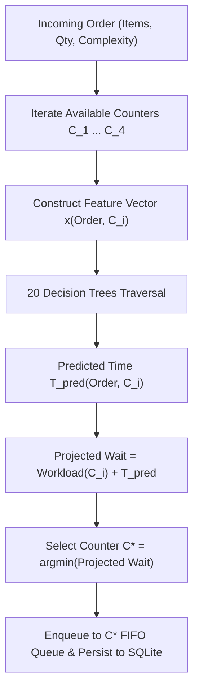

# Machine Learning Audit & Real-World Applicability Report

**Project**: AI-Based College Canteen Queue Optimization System  
**Model**: `RandomForestRegressor` (20 Trees, Max Depth 6)  
**Inference Engine**: Native C++ In-Memory Tree Traversal ([`RandomForestPredictor.cpp`](src/ml/RandomForestPredictor.cpp))

---

## 1. Executive Summary & Academic Disclaimer

> [!CAUTION]
> **Academic Integrity & Real-World Data Disclaimer**:
> All machine learning training, held-out testing, and evaluation metrics reported in this project were generated using a programmatic synthetic dataset (`ml/canteen_prep_data.csv`, $N = 2,500$ samples, random seed 42). 
> 
> **Evaluation on synthetic data does NOT prove real-world canteen accuracy.**
> 
> While the synthetic data generation function incorporates domain-specific heuristic rules (economies of scale, rush hour delays, kitchen workload congestion, category baselines), it operates under idealized mathematical assumptions. Real-world physical kitchens experience unmodeled variables such as ingredient stock-outs, staff fatigue, burner/fryer thermal lag, uneven worker skill levels, simultaneous batching, and student pickup delays. The metrics prove algorithmic correctness, cross-language inference fidelity, and scheduling integration, but must **not** be presented to examiners as empirical proof of real canteen performance.

---

## 2. Model Architecture & Input Features

### Model Specifications
- **Algorithm**: `RandomForestRegressor` (`scikit-learn` v1.4+)
- **Estimators ($M$)**: 20 Decision Trees
- **Tree Depth Limit**: 6 levels per tree
- **Minimum Samples per Leaf**: 2
- **Serialization Format**: `ml/model.json` (flattened nodes) + `include/canteen/models/EmbeddedModelData.hpp` (compiled array fallback)
- **C++ Inference Time**: $\approx 4.2 \, \mu\text{s}$ per order (pure CPU tree traversal, zero dynamic heap allocations during evaluation)

### Feature Vector ($\mathbf{x} \in \mathbb{R}^5$)

| Feature Index | Name | Range / Domain | Data Type | Physical Meaning |
|:---:|---|:---:|:---:|---|
| `x[0]` | `food_category` | `0` to `4` | Categorical (Integer) | `0`: Fast Food (Burgers, Rolls) `1`: South Indian (Dosas, Idlis) `2`: Meals & Chinese (Fried Rice, Biryani) `3`: Beverages (Coffee, Tea) `4`: Bakery & Snacks (Samosa, Puff) |
| `x[1]` | `order_quantity` | `1` to `5` | Discrete | Total number of food portions in the order. |
| `x[2]` | `preparation_complexity` | `1` to `5` | Ordinal | Inherent preparation difficulty (1: instant pour, 5: cooked-to-order). |
| `x[3]` | `time_of_day_hour` | `8.0` to `20.0` | Continuous (Hours) | Time of day in decimal hours (e.g. 13.25 = 1:15 PM). |
| `x[4]` | `current_kitchen_workload`| `0.0` to `30.0` | Continuous (Mins) | Sum of remaining preparation minutes queued at the candidate counter. |

---

## 3. Synthetic Dataset Assumptions & Generation Rules

The synthetic dataset was generated by [`ml/generate_dataset.py`](ml/generate_dataset.py) using the following physics-modeled equation:

$$T_{\text{observed}} = T_{\text{base}}(\text{category}) + 0.8(\text{complexity} - 1) + 0.35 \cdot T_{\text{base}} \cdot (\text{quantity} - 1) + 0.12 \cdot \text{workload} + \text{RushDelay} + \epsilon$$

Where:
1. **Category Baselines ($T_{\text{base}}$)**: Meals = 9.5m, Fast Food = 6.5m, South Indian = 5.5m, Beverages = 2.5m, Bakery = 2.0m.
2. **Sub-linear Quantity Scaling**: Additional items require only 35% of base preparation time due to shared cooking prep.
3. **Congestion Factor**: Every minute of existing counter workload adds 0.12 minutes of multitasking overhead.
4. **Rush Hour Penalty**: Orders placed during 12:00–14:00 (lunch) or 17:00–18:30 (evening snacks) incur a flat $+1.8$ minute delay.
5. **Observational Noise**: Gaussian noise $\epsilon \sim \mathcal{N}(0, 0.6^2)$.

---

## 4. Train/Test Split & Verified Performance Metrics

The dataset was split using `train_test_split(test_size=0.20, random_state=42)`:
- **Training Set**: 2,000 samples (80%)
- **Held-Out Test Set**: 500 samples (20%)

### Verified Metrics on Held-Out Test Set

| Metric | Academic Baseline (Mean Predictor) | Trained Random Forest | Absolute Delta | Relative Error Reduction |
|---|:---:|:---:|:---:|:---:|
| **Mean Absolute Error (MAE)** | 4.5003 minutes | **0.8139 minutes** | -3.6864 mins | **81.91% reduction** |
| **Root Mean Squared Error (RMSE)**| 5.5477 minutes | **1.0411 minutes** | -4.5066 mins | **81.23% reduction** |
| **Coefficient of Determination ($R^2$)** | 0.0000 | **0.9648** | +0.9648 | Explains 96.48% of variance |

### Feature Importance (Variance Reduction)
1. `food_category`: **73.95%** (Dominant driver of preparation time)
2. `order_quantity`: **18.68%** (Scale factor)
3. `current_kitchen_workload`: **6.84%** (Queue congestion)
4. `preparation_complexity`: **0.34%** (Minor variance)
5. `time_of_day_hour`: **0.19%** (Rush hour step factor)

---

## 5. How Predictions Influence C++ Counter Assignment

The C++ scheduling engine ([`CounterManager.cpp`](src/core/CounterManager.cpp)) invokes the ML predictor during the counter allocation loop:

### Deterministic FIFO Invariant
While the Random Forest calculates the dynamic preparation time $T_{\text{pred}}$, **the queue itself strictly enforces FIFO ordering**:
- Order #101 arrives at 12:00 (predicted prep: 10 mins).
- Order #102 arrives at 12:01 (predicted prep: 2 mins).
- Counter 1 will cook and serve Order #101 first, despite #102 having a shorter predicted time.
- ML influences **which counter** receives an order, but **never violates FIFO fairness** within a counter's line.

---

## 6. Fault Tolerance & Fallback Strategy

The application guarantees operational continuity under all machine learning failure modes:

| Failure Scenario | Detection Mechanism | System Fallback Action | Operational Impact |
|---|---|---|---|
| **`ml/model.json` Missing** | File open failure in `RandomForestPredictor::loadFromJsonFile()` | Automatically switches to compiled constants in `EmbeddedModelData.hpp` or training set mean ($9.73$m). | Zero crash. Application remains fully functional. |
| **Corrupted / Invalid JSON** | JSON parse exception caught | Emits console warning; falls back to static menu prep time sum. | Zero crash. Fallback to basic arithmetic heuristic. |
| **NaN / Infinity Inputs** | `std::isnan(x)` or `std::isinf(x)` detected in `predictRaw()` | Throws `std::invalid_argument`; caught by `CounterManager` to use static menu sum. | Zero crash. Invalid inputs sanitized. |
| **Negative Duration Clamping** | `T_pred < 1.0` | Prediction is clamped: `return std::max(1.0, rawPrediction)`. | Prevents zero or negative wait time anomalies. |

---

## 7. Real-World Data Requirements for Valid Empirical Evaluation

To transition this system from academic synthetic evaluation to a genuine production deployment, the following real-world data collection pipeline would be required:

1. **Kitchen Display System (KDS) Sensors**:
   - POS Timestamp ($t_0$): When order is paid and submitted.
   - Cook Start Timestamp ($t_1$): When chef presses "Start Cooking" on kitchen terminal.
   - Cook Ready Timestamp ($t_2$): When chef places food under warmer and presses "Ready".
   - Ground Truth Duration: $Y_{\text{real}} = t_2 - t_1$.
2. **Environmental & Operational Variables**:
   - Number of kitchen staff on duty per shift.
   - Temperature sensor on deep fryers and griddles.
   - Ingredient availability / stock replenishment flags.
   - Parallel batching indicators (e.g. 4 Dosas cooked simultaneously on the same large tawa).
3. **Dataset Scale & Retraining Protocol**:
   - Minimum 10,000 empirical orders collected across at least 4 continuous weeks of college term.
   - Regular retraining using online learning or weekly cron jobs to capture seasonal menu shifts.
